# 点餐平台网站

> 🎓 **计算机毕业设计 · 点餐平台网站**
>
> 本仓库只放**项目介绍 + 运行截图**（截图是站点带水印的原图，存在仓库 `images/` 里）。
>
> 👉 **完整可运行源码 / 数据库脚本 / 部署文档：[点我获取](https://geekcode.top/archives/%E7%82%B9%E9%A4%90%E5%B9%B3%E5%8F%B0%E7%BD%91%E7%AB%99?utm_source=github)**
>
> 💬 咨询微信：**ir9372**　|　🌐 更多项目：[极客代码 geekcode.top](https://geekcode.top/?utm_source=github)
>
> 📌 项目详情页：<https://geekcode.top/archives/%E7%82%B9%E9%A4%90%E5%B9%B3%E5%8F%B0%E7%BD%91%E7%AB%99?utm_source=github>

<table><td width="230" align="center"> <b>扫码加微信 ir9372</b></td><td valign="middle">📦 源码 = 项目介绍 + 全部运行截图 + 数据库 + 部署文档 👉 点上方任意截图，直接跳到 <b>极客代码 geekcode.top</b> 详情页</td></table>

---

<h1>点餐平台网站</h1>
<h2>项目概述</h2>

本项目名为“点餐平台网站”，旨在构建一个集菜品展示、在线下单、用户互动及后台管理于一体的综合性餐饮服务平台。项目采用前后端分离架构，前端基于 Vue 框架实现响应式界面，后端使用 Spring Boot 提供 RESTful API 服务，数据库选用 MySQL 并通过 MyBatis-Plus 进行持久层操作，权限控制依赖 Apache Shiro。

核心功能涵盖前台用户的菜品浏览、资讯阅读、购物车管理、订单提交、地址维护、收藏记录及评论互动；后台管理员则具备对菜品信息、分类、评价、订单、用户资料、轮播图配置及在线客服的全方位管理能力。该平台适用于中小型餐饮企业或校园食堂场景，通过数字化手段优化点餐流程，提升用户体验与运营效率，解决传统人工点餐效率低、信息不透明及数据难以沉淀的问题。

<h2>技术架构</h2>
<h3>1. 系统总体架构</h3>

项目采用典型的 B/S（Browser/Server）架构模式，具体分为表现层、业务逻辑层和数据访问层。

<a href="https://geekcode.top/archives/%E7%82%B9%E9%A4%90%E5%B9%B3%E5%8F%B0%E7%BD%91%E7%AB%99?utm_source=github" title="查看完整源码">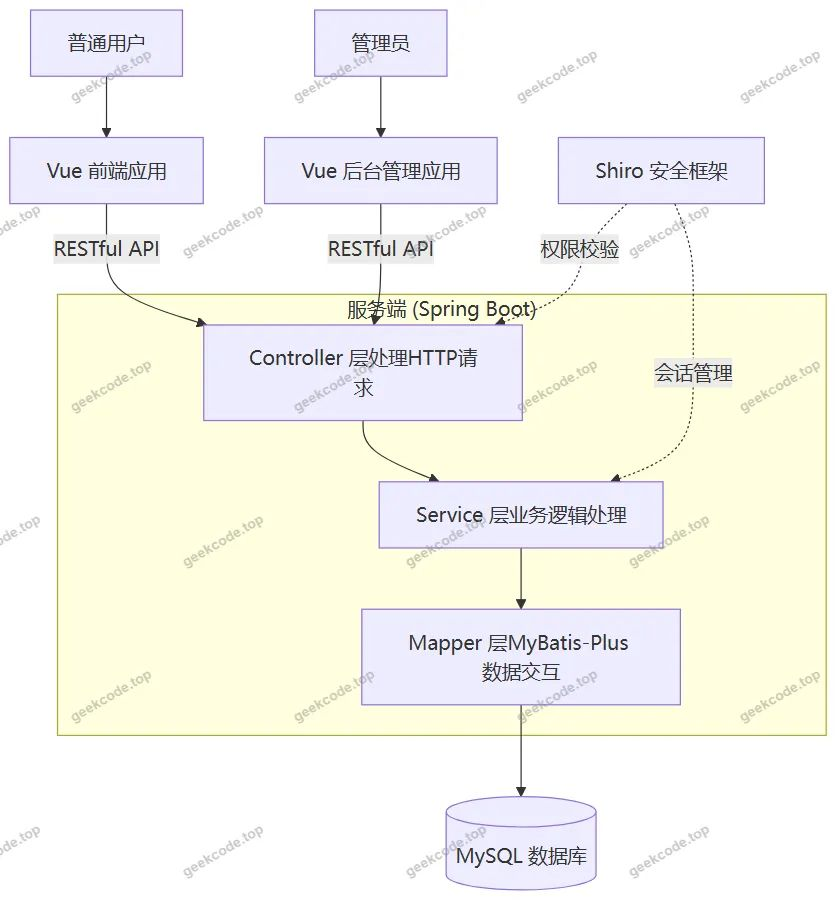</a>

<h3>2. 核心技术选型理由</h3>
<ul>
<li><strong>Spring Boot</strong>: 作为后端基础框架，利用其自动配置和起步依赖特性，简化了 Spring 应用的搭建过程，提供了稳定的 Web 服务能力（<code>spring-boot-starter-web</code>）。</li>
<li><strong>MyBatis-Plus</strong>: 在 MyBatis 的基础上增强，提供了通用的 CRUD 接口和条件构造器，显著减少了样板代码，提升了开发效率（<code>mybatis-plus</code>, <code>mybatis-spring-boot-starter</code>）。</li>
<li><strong>Apache Shiro</strong>: 用于实现细粒度的权限控制和身份认证。相比 Spring Security，Shiro 更轻量且易于集成，适合本项目的用户角色管理需求（<code>shiro-spring</code>）。</li>
<li><strong>MySQL</strong>: 作为关系型数据库存储核心业务数据，配合 <code>mysql-connector-java</code> 驱动实现高效的数据读写。</li>
<li><strong>Vue.js (Integrated)</strong>: 前端采用 Vue 框架，结合路由管理和组件化开发思想，实现了前后台页面的动态渲染与交互。</li>
</ul>
<h3>3. 数据库设计要点</h3>

根据控制器与实体映射关系，数据库主要包含以下核心表结构：

<ul>
<li><strong>用户相关</strong>: <code>yonghu</code> (用户表), <code>address</code> (收货地址表)。</li>
<li><strong>商品相关</strong>: <code>caipinxinxi</code> (菜品信息表), <code>caipinfenlei</code> (菜品分类表)。</li>
<li><strong>交易相关</strong>: <code>orders</code> (订单表), <code>cart</code> (购物车表), <code>storeup</code> (收藏表)。</li>
<li><strong>内容互动</strong>: <code>news</code> (菜品资讯表), <code>caipinpingjia</code> (菜品评价表), <code>discusscaipinxinxi</code> (菜品评论表), <code>chat</code> (在线客服聊天记录)。</li>
<li><strong>系统配置</strong>: <code>config</code> (轮播图及系统参数配置)。</li>
</ul>
<h2>功能模块</h2>
<h3>1. 前台用户端</h3>

前台面向普通消费者，提供完整的点餐与服务体验闭环。

<table>
<thead>
<tr>
<th align="left">模块名称</th>
<th align="left">功能描述</th>
</tr>
</thead>
<tbody><tr>
<td align="left"><strong>首页展示</strong></td>
<td align="left">展示轮播图、推荐菜品及最新资讯，支持快速导航至各功能板块。</td>
</tr>
<tr>
<td align="left"><strong>登录/注册</strong></td>
<td align="left">新用户可通过注册页面创建账号，老用户通过登录页进入个人中心。</td>
</tr>
<tr>
<td align="left"><strong>菜品信息</strong></td>
<td align="left">列表展示所有菜品，支持按分类筛选；详情页展示菜品图片、价格、描述及关联的评论列表。</td>
</tr>
<tr>
<td align="left"><strong>菜品资讯</strong></td>
<td align="left">展示餐饮新闻或美食攻略，支持列表浏览及详情查看。</td>
</tr>
<tr>
<td align="left"><strong>购物车</strong></td>
<td align="left">用户可将心仪菜品加入购物车，实时查看已选菜品总价，支持删除或修改数量后结算生成订单。</td>
</tr>
<tr>
<td align="left"><strong>个人中心</strong></td>
<td align="left">用户信息聚合入口，包含基本资料修改、密码重置等功能。</td>
</tr>
<tr>
<td align="left"><strong>我的订单</strong></td>
<td align="left">查看历史订单状态（如待支付、已完成等），支持订单详情查询。</td>
</tr>
<tr>
<td align="left"><strong>我的地址</strong></td>
<td align="left">管理收货地址，支持新增、编辑、删除及设为默认地址。</td>
</tr>
<tr>
<td align="left"><strong>我的收藏</strong></td>
<td align="left">展示用户收藏的菜品列表，方便快速回访购买。</td>
</tr>
<tr>
<td align="left"><strong>评论与评价</strong></td>
<td align="left">用户可对菜品发表评论，也可针对已完成的订单进行星级评价，支持查看自己的评价记录。</td>
</tr>
<tr>
<td align="left"><strong>在线客服</strong></td>
<td align="left">提供即时通讯窗口，用户可与商家客服沟通咨询。</td>
</tr>
</tbody></table>
<h3>2. 后台管理端</h3>

后台面向管理员，负责平台数据的维护与业务监控。

<table>
<thead>
<tr>
<th align="left">模块名称</th>
<th align="left">功能描述</th>
</tr>
</thead>
<tbody><tr>
<td align="left"><strong>仪表盘</strong></td>
<td align="left">后台首页，展示关键数据统计概览。</td>
</tr>
<tr>
<td align="left"><strong>菜品信息管理</strong></td>
<td align="left">对菜品进行增删改查，上传菜品图片，设置价格与库存，关联分类。</td>
</tr>
<tr>
<td align="left"><strong>菜品分类管理</strong></td>
<td align="left">维护菜品的类别体系，如主食、小吃、饮品等，支持分类的新建与排序。</td>
</tr>
<tr>
<td align="left"><strong>订单管理</strong></td>
<td align="left">查看所有用户订单，处理订单状态变更（如发货、退款审核），支持按状态筛选。</td>
</tr>
<tr>
<td align="left"><strong>用户管理</strong></td>
<td align="left">管理平台注册用户，查看用户基本信息，支持禁用异常账号。</td>
</tr>
<tr>
<td align="left"><strong>资讯管理</strong></td>
<td align="left">发布和维护菜品相关的新闻资讯，控制前台展示内容。</td>
</tr>
<tr>
<td align="left"><strong>评价管理</strong></td>
<td align="left">审核用户提交的菜品评价，删除违规或不实评价。</td>
</tr>
<tr>
<td align="left"><strong>评论管理</strong></td>
<td align="left">监控菜品下方的用户讨论区，维护社区秩序。</td>
</tr>
<tr>
<td align="left"><strong>收藏管理</strong></td>
<td align="left">查看用户的收藏行为数据，辅助分析热门菜品。</td>
</tr>
<tr>
<td align="left"><strong>轮播图配置</strong></td>
<td align="left">管理系统首页及各模块的轮播广告位，上传图片并设置跳转链接。</td>
</tr>
<tr>
<td align="left"><strong>在线客服</strong></td>
<td align="left">管理员在此模块回复用户发起的在线咨询消息。</td>
</tr>
</tbody></table>
<h2>用户角色与权限</h2>

本项目基于 Shiro 框架实现权限控制，主要划分为两个角色：<strong>普通用户</strong>和<strong>系统管理员</strong>。

<h3>1. 普通用户 (User)</h3>
<ul>
<li><strong>认证要求</strong>: 需注册并登录后方可使用核心功能。</li>
<li><strong>可访问模块</strong>:</li>
<li><strong>公共浏览</strong>: 首页、菜品列表、菜品详情、资讯列表、资讯详情、菜品分类。</li>
<li><strong>个人事务</strong>: 个人中心、我的订单、我的地址、我的收藏、购物车。</li>
<li><strong>互动功能</strong>: 发表菜品评论、提交菜品评价、参与在线客服聊天。</li>
<li><strong>受限操作</strong>: 无法进入后台管理页面，无法直接修改数据库底层配置，只能管理属于自己的数据（如仅能删除自己的地址或订单）。</li>
</ul>
<h3>2. 系统管理员 (Admin)</h3>
<ul>
<li><strong>认证要求</strong>: 拥有专用后台登录入口，通常由超级管理员分配账号。</li>
<li><strong>可访问模块</strong>:</li>
<li><strong>全量数据管理</strong>: 对所有菜品、分类、资讯、用户、订单数据进行增删改查。</li>
<li><strong>系统配置</strong>: 管理轮播图、系统参数。</li>
<li><strong>内容审核</strong>: 管理所有用户的评价和评论内容。</li>
<li><strong>客户服务</strong>: 接入在线客服系统，回复任意用户的咨询。</li>
<li><strong>权限边界</strong>: 管理员拥有最高权限，可查看全站统计数据，但通常不建议直接修改其他管理员的配置（若存在多管理员层级，依据具体 Shiro 配置而定，当前上下文显示为单一管理视角）。</li>
</ul>
<h2>项目特色与创新点</h2>
<ol>
<li><strong>完整的前后端的业务闭环</strong>：项目不仅实现了基础的展示功能，还打通了从“浏览-加购-下单-评价”的用户全流程，以及对应的后台“接单-发货-售后-统计”的管理全流程，具备实际商用价值。</li>
<li><strong>多维度的互动机制</strong>：除了传统的订单交易，项目引入了“菜品资讯”、“评论区”、“评价体系”和“在线客服”四大互动模块，增强了用户粘性和平台活跃度，模拟了真实社交电商的体验。</li>
<li><strong>轻量级高性能架构</strong>：采用 Spring Boot + MyBatis-Plus 组合，在保证开发效率的同时，通过 Shiro 实现轻量级的安全控制，避免了重型框架带来的资源浪费，适合中小型部署环境。</li>
<li><strong>灵活的配置管理</strong>：通过独立的 <code>ConfigController</code> 和轮播图管理模块，实现了前端展示内容的动态配置，无需重新编译代码即可更新首页广告位和系统参数，提升了运维灵活性。</li>
</ol>
<h2>部署环境</h2>

为确保项目正常运行，需要准备以下软硬件环境：

<h3>1. 硬件环境</h3>
<ul>
<li><strong>服务器/PC</strong>: CPU 双核以上，内存建议 4GB 及以上，硬盘空间至少 10GB。</li>
</ul>
<h3>2. 软件环境</h3>
<ul>
<li><strong>JDK</strong>: Java Development Kit 1.8 或更高版本（Spring Boot 2.x 系列兼容 JDK 8+）。</li>
<li><strong>数据库</strong>: MySQL 5.7 或 MySQL 8.0。需初始化数据库脚本以创建表结构和基础数据。</li>
<li><strong>构建工具</strong>: Maven 3.6+（用于后端依赖管理和打包）。</li>
<li><strong>Node.js</strong>: 版本建议 14.x 或 16.x LTS（用于前端 Vue 项目的依赖安装与编译打包）。</li>
<li><strong>Web 服务器</strong>: Nginx 或 Tomcat（若后端独立部署则需 Tomcat，若前后端分离部署通常前端静态资源由 Nginx 托管，后端由内置 Tomcat 运行）。</li>
</ul>
<h3>3. 开发工具（可选）</h3>
<ul>
<li>IDE: IntelliJ IDEA 或 Eclipse。</li>
<li>浏览器: Chrome, Firefox, Edge 等现代浏览器。</li>
</ul>
<h2>五、技术特性</h2>
<ul>
<li>前后端集成部署，前端资源打包至后端 static 目录</li>
<li>使用 MyBatis-Plus 简化数据访问层开发</li>
<li>集成 Shiro 权限框架实现角色权限控制</li>
</ul>
<h2>六、功能模块截图</h2>
<h3>前台用户端</h3>
<h4>前台首页</h4>

<a href="https://geekcode.top/archives/%E7%82%B9%E9%A4%90%E5%B9%B3%E5%8F%B0%E7%BD%91%E7%AB%99?utm_source=github" title="查看完整源码">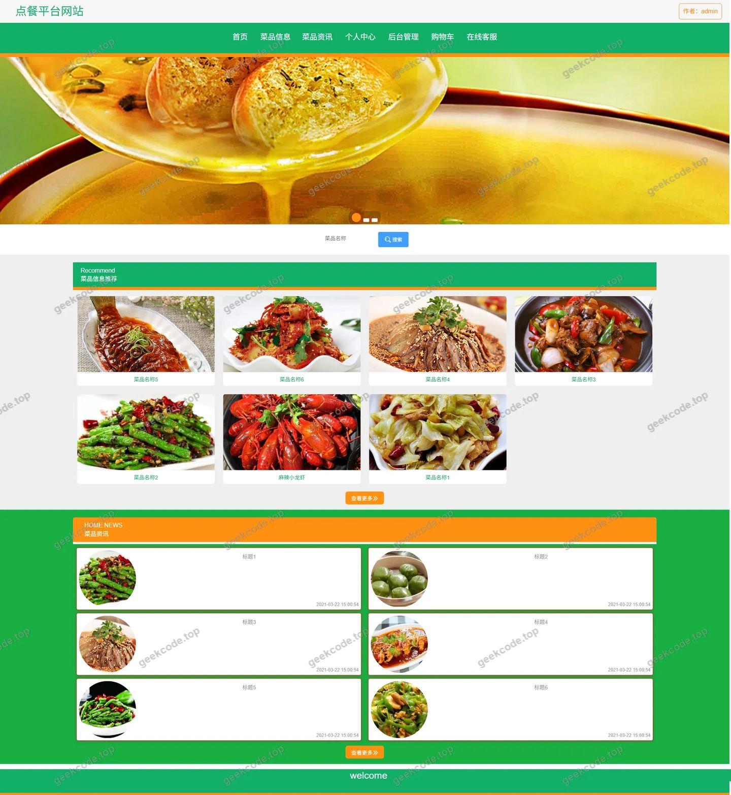</a>

<h4>前台登录页</h4>

<h4>前台注册页</h4>

<h4>前台-菜品信息列表</h4>

<a href="https://geekcode.top/archives/%E7%82%B9%E9%A4%90%E5%B9%B3%E5%8F%B0%E7%BD%91%E7%AB%99?utm_source=github" title="查看完整源码">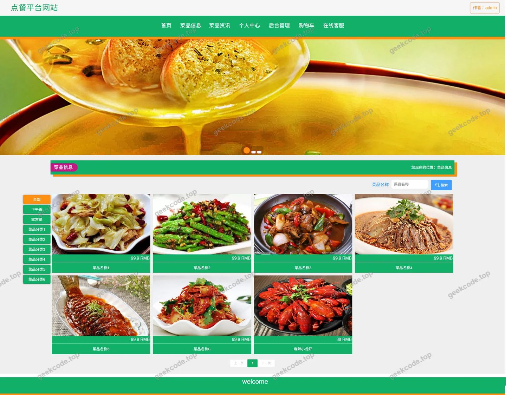</a>

<h4>前台-菜品资讯列表</h4>

<a href="https://geekcode.top/archives/%E7%82%B9%E9%A4%90%E5%B9%B3%E5%8F%B0%E7%BD%91%E7%AB%99?utm_source=github" title="查看完整源码">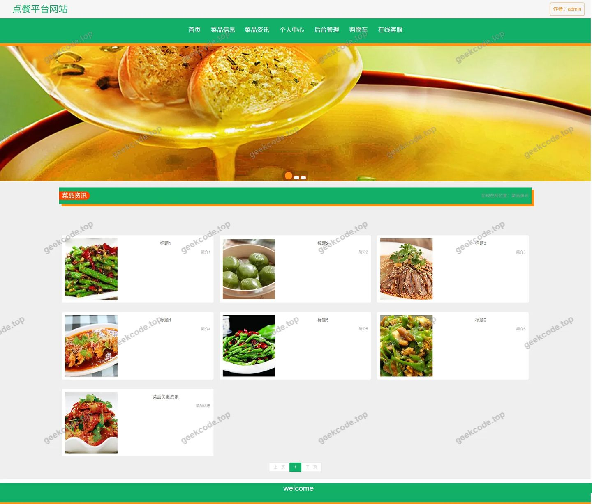</a>

<h4>前台-菜品信息评论列表</h4>

<h4>前台个人中心</h4>

<a href="https://geekcode.top/archives/%E7%82%B9%E9%A4%90%E5%B9%B3%E5%8F%B0%E7%BD%91%E7%AB%99?utm_source=github" title="查看完整源码">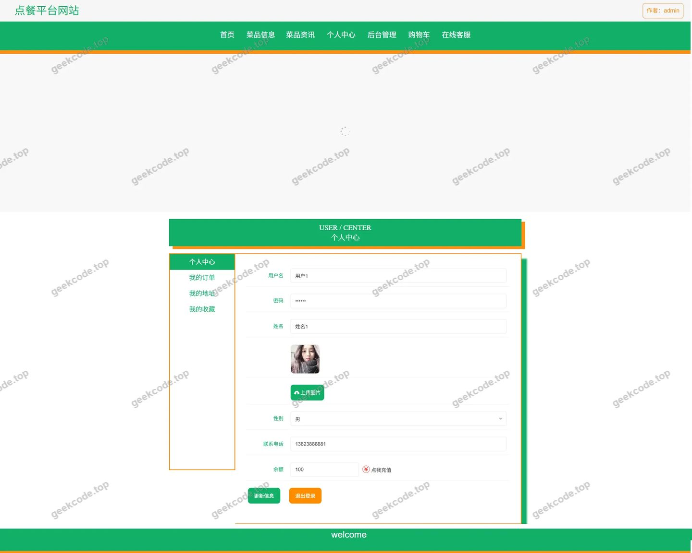</a>

<h4>前台-我的地址列表</h4>

<a href="https://geekcode.top/archives/%E7%82%B9%E9%A4%90%E5%B9%B3%E5%8F%B0%E7%BD%91%E7%AB%99?utm_source=github" title="查看完整源码">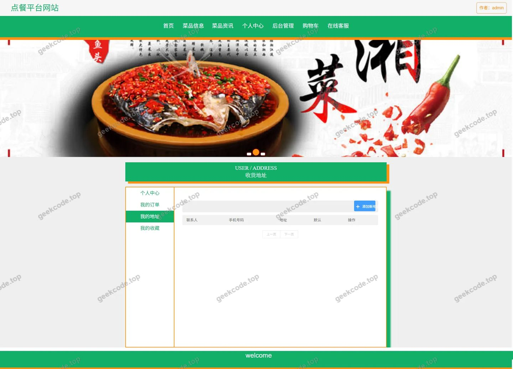</a>

<h4>前台-我的订单列表</h4>

<a href="https://geekcode.top/archives/%E7%82%B9%E9%A4%90%E5%B9%B3%E5%8F%B0%E7%BD%91%E7%AB%99?utm_source=github" title="查看完整源码">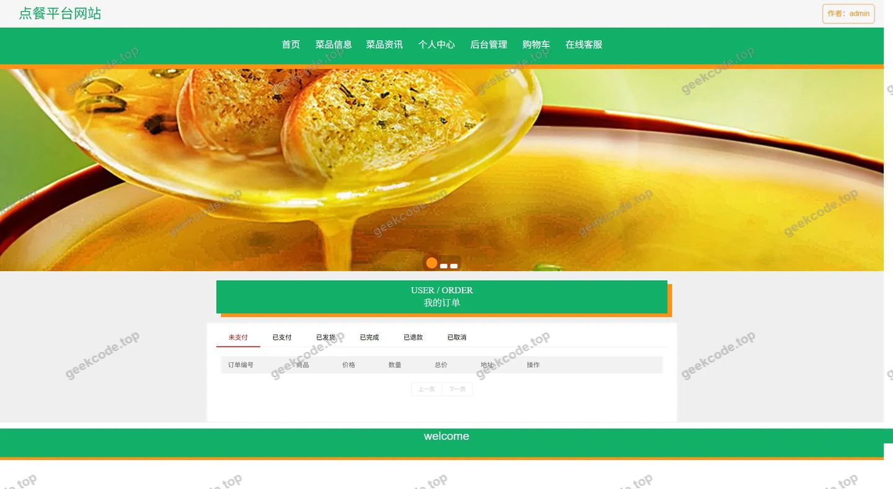</a>

<h4>前台-我的收藏列表</h4>

<h4>前台-菜品信息-详情</h4>

<a href="https://geekcode.top/archives/%E7%82%B9%E9%A4%90%E5%B9%B3%E5%8F%B0%E7%BD%91%E7%AB%99?utm_source=github" title="查看完整源码">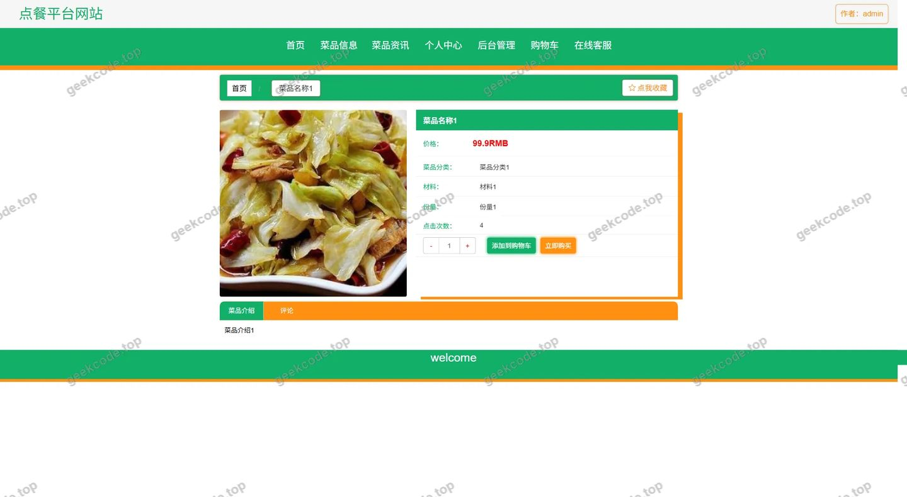</a>

<h4>前台-菜品资讯-详情</h4>

<h4>前台-菜品分类列表</h4>

<h4>前台-菜品评价列表</h4>

<a href="https://geekcode.top/archives/%E7%82%B9%E9%A4%90%E5%B9%B3%E5%8F%B0%E7%BD%91%E7%AB%99?utm_source=github" title="查看完整源码">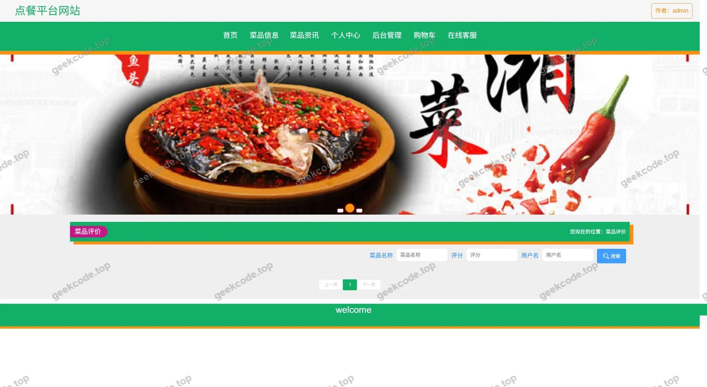</a>

<h4>前台-购物车列表</h4>

<h4>前台-菜品评价-详情</h4>

<a href="https://geekcode.top/archives/%E7%82%B9%E9%A4%90%E5%B9%B3%E5%8F%B0%E7%BD%91%E7%AB%99?utm_source=github" title="查看完整源码">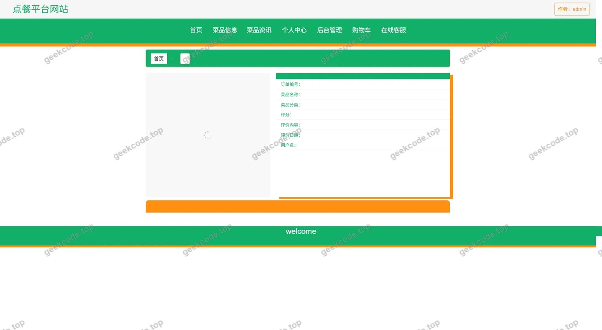</a>

<h4>前台-菜品信息评论-详情</h4>

<h3>后台管理端</h3>
<h4>后台-菜品分类</h4>

<a href="https://geekcode.top/archives/%E7%82%B9%E9%A4%90%E5%B9%B3%E5%8F%B0%E7%BD%91%E7%AB%99?utm_source=github" title="查看完整源码">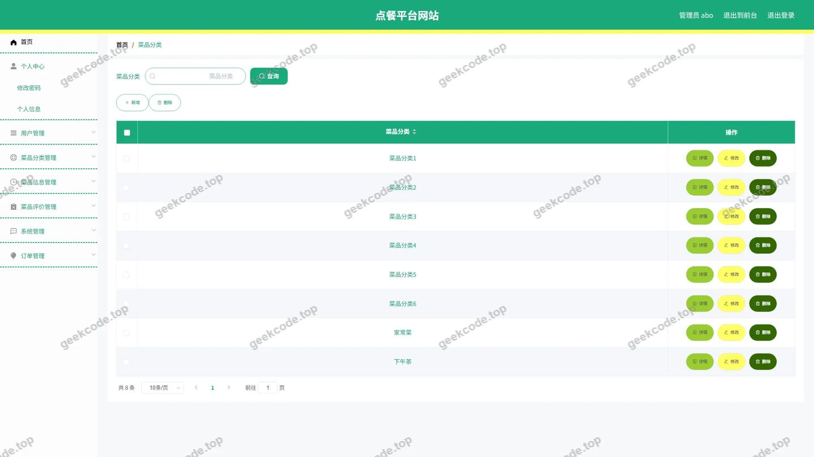</a>

<h4>后台-菜品评价</h4>

<a href="https://geekcode.top/archives/%E7%82%B9%E9%A4%90%E5%B9%B3%E5%8F%B0%E7%BD%91%E7%AB%99?utm_source=github" title="查看完整源码">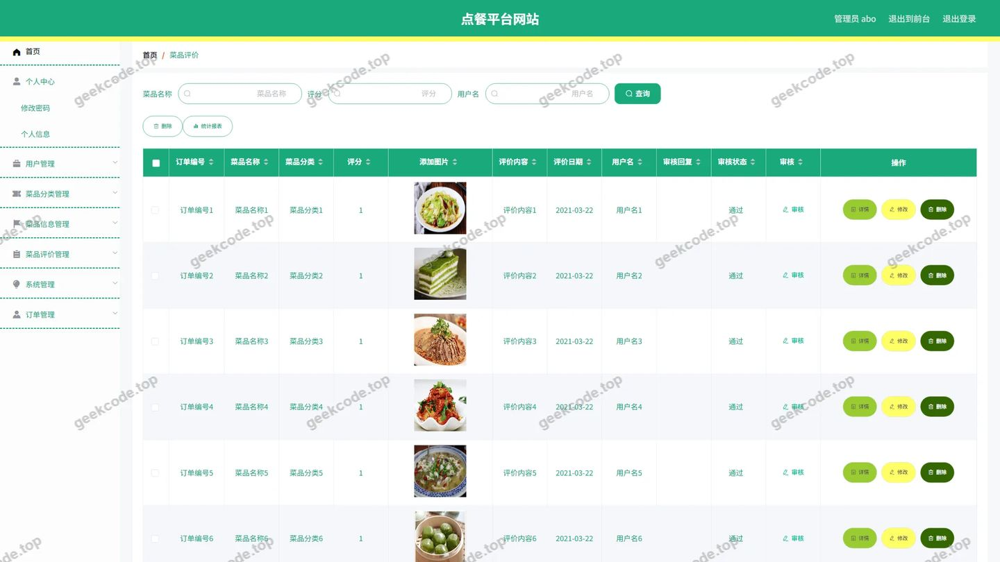</a>

<h4>后台-菜品信息</h4>

<a href="https://geekcode.top/archives/%E7%82%B9%E9%A4%90%E5%B9%B3%E5%8F%B0%E7%BD%91%E7%AB%99?utm_source=github" title="查看完整源码">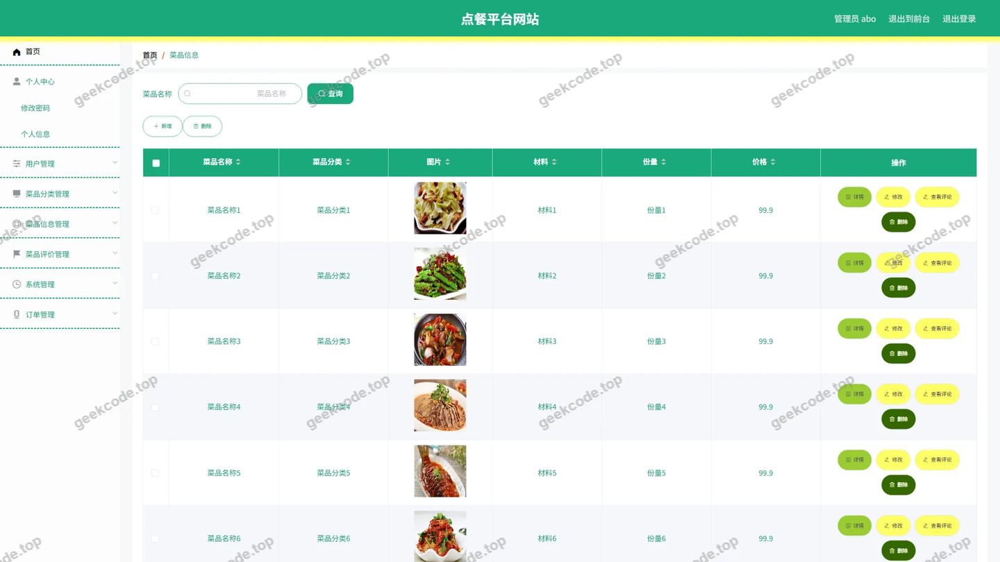</a>

<h4>后台-在线客服</h4>

<a href="https://geekcode.top/archives/%E7%82%B9%E9%A4%90%E5%B9%B3%E5%8F%B0%E7%BD%91%E7%AB%99?utm_source=github" title="查看完整源码">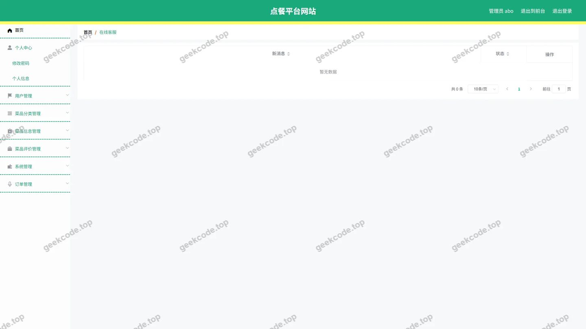</a>

<h4>后台-系统配置</h4>

<a href="https://geekcode.top/archives/%E7%82%B9%E9%A4%90%E5%B9%B3%E5%8F%B0%E7%BD%91%E7%AB%99?utm_source=github" title="查看完整源码">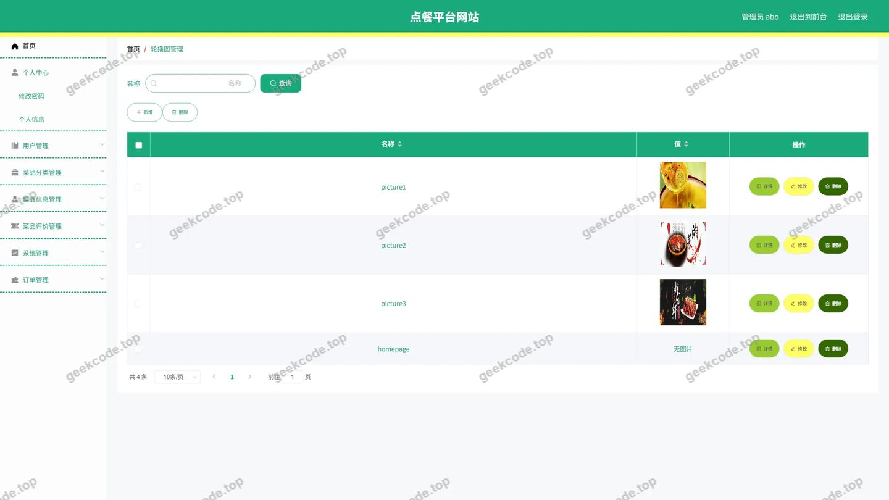</a>

<h4>后台-菜品信息评论</h4>

<a href="https://geekcode.top/archives/%E7%82%B9%E9%A4%90%E5%B9%B3%E5%8F%B0%E7%BD%91%E7%AB%99?utm_source=github" title="查看完整源码">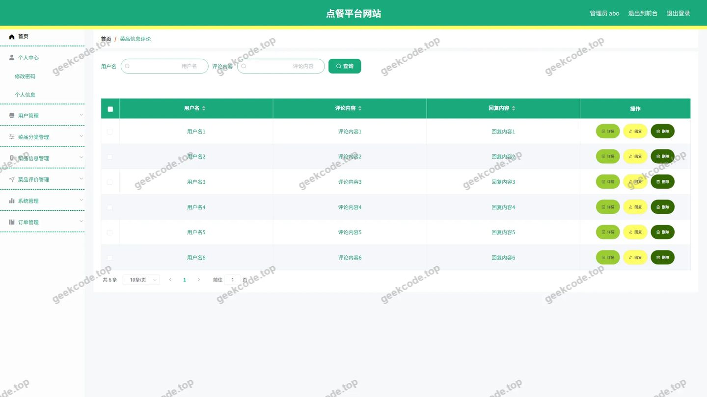</a>

<h4>后台首页</h4>

<a href="https://geekcode.top/archives/%E7%82%B9%E9%A4%90%E5%B9%B3%E5%8F%B0%E7%BD%91%E7%AB%99?utm_source=github" title="查看完整源码">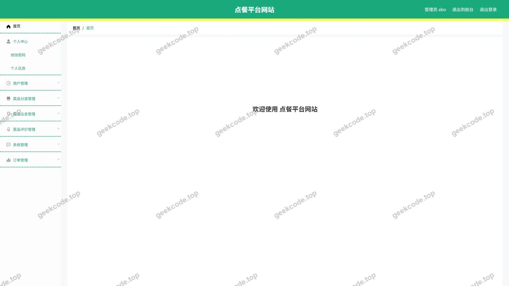</a>

<h4>后台-登录</h4>

<h4>后台-公告信息</h4>

<a href="https://geekcode.top/archives/%E7%82%B9%E9%A4%90%E5%B9%B3%E5%8F%B0%E7%BD%91%E7%AB%99?utm_source=github" title="查看完整源码">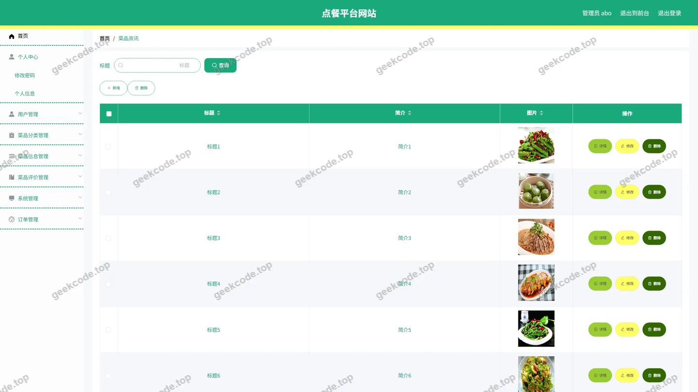</a>

<h4>后台-订单-状态</h4>

<a href="https://geekcode.top/archives/%E7%82%B9%E9%A4%90%E5%B9%B3%E5%8F%B0%E7%BD%91%E7%AB%99?utm_source=github" title="查看完整源码">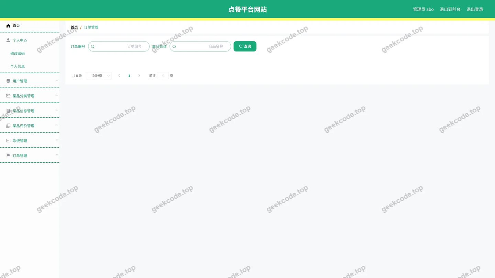</a>

<h4>后台-收藏</h4>

<a href="https://geekcode.top/archives/%E7%82%B9%E9%A4%90%E5%B9%B3%E5%8F%B0%E7%BD%91%E7%AB%99?utm_source=github" title="查看完整源码">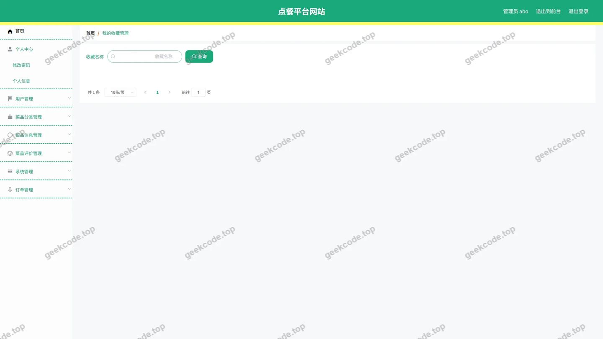</a>

---

## 获取完整源码

| 项目 | 说明 |
| --- | --- |
| 项目名 | 点餐平台网站 |
| 运行截图 | 本文 29 张（站点带水印原图，仓库 `images/` 目录） |
| 完整源码 | [https://geekcode.top/archives/%E7%82%B9%E9%A4%90%E5%B9%B3%E5%8F%B0%E7%BD%91%E7%AB%99?utm_source=github](https://geekcode.top/archives/%E7%82%B9%E9%A4%90%E5%B9%B3%E5%8F%B0%E7%BD%91%E7%AB%99?utm_source=github) |
| 咨询微信 | **ir9372**（备注：jingpin-yuanma） |
| 更多项目 | [极客代码 geekcode.top](https://geekcode.top/?utm_source=github) |

> 需要源码、部署、改配置、跑不起来等问题，加微信 ir9372 沟通，说明项目名即可。
